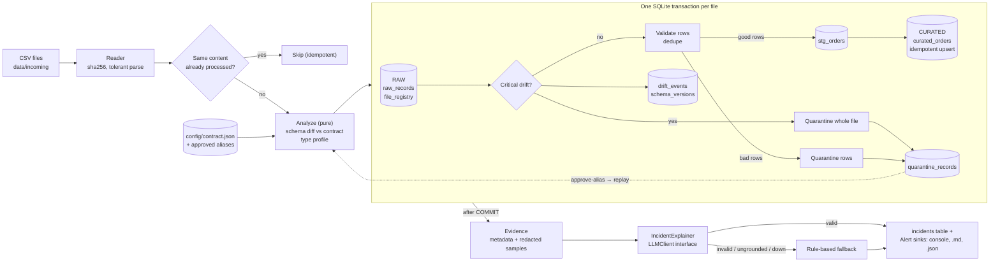

# Schema Drift Handler

A file-ingestion pipeline whose source schema **changes while it runs**. It detects the change, **quarantines the
incompatible records** (never silently drops or mis-loads them), raises a **clear alert**, and attaches an
**AI-assisted incident explanation** that is validated before anyone is allowed to trust it.

Assignment DAI-028 · Track: Data Quality · Python + SQL (SQLite) · standard library only · synthetic data only.

---

## 1. Problem statement

A producer sends one CSV of `orders` per day. Over six days the feed drifts: columns are reordered, a column is added,
an optional column vanishes, two required columns are renamed, a date format flips for a third of the rows, and finally
every `amount` turns into a string like `Rs 1,299.00`.

A naive loader would either crash, or — worse — load wrong data (NULL amounts, shifted columns). Required behaviour:

1. **Detect** the schema change and classify it (benign / warning / breaking).
2. **Quarantine** incompatible records, keep everything else flowing, lose nothing.
3. **Alert** with enough detail to act on.
4. **Explain** the incident in plain language with AI, safely.
5. Be **re-runnable** (idempotent) and recoverable once the producer confirms a change.

## 2. Approach in one paragraph

Deterministic code decides everything about the data (what drifted, what is loaded, what is quarantined). The
model is **advisory and off the data path**: it only writes the incident explanation and proposes a rename mapping,
and its reply is treated as untrusted input — schema-checked, grounded against the evidence, confidence-gated,
retried once, and replaced by a rule-based explanation if unusable. A model outage can therefore never block, corrupt
or delay ingestion.

## 3. Architecture / data flow



More detail in [`docs/architecture.md`](docs/architecture.md).

## 4. Technologies

Python 3 (stdlib only: `csv`, `sqlite3`, `urllib`, `unittest`) · SQLite (UPSERT, partial unique index, set-based SQL) · optional free LLM via any OpenAI-compatible endpoint (Ollama local, Groq, OpenRouter…). No third-party runtime
dependencies. Developed and tested on Python 3.13 / SQLite 3.45 (UPSERT needs SQLite ≥ 3.24).

## 5. Project structure

```
config/contract.json         expected schema, rules, thresholds, approved aliases (the "source of truth")
data/incoming/               synthetic six-day feed (committed; regenerate with `generate-data`, same seed => same bytes)
sql/schema.sql               data model: RAW / STAGING / CURATED / CONTROL tables
sql/load_curated.sql         set-based idempotent upsert policy (staging -> curated)
sql/count_load_effect.sql    how many rows that upsert will insert / update / leave unchanged
sql/analytics.sql            reporting queries behind `report`
src/schema_drift/
  reader.py                  tolerant CSV reader (never raises on bad *data*)
  contract.py  validate.py   contract model, row-level validation
  drift.py                   deterministic schema-drift detection (diff, rename inference, type drift)
  pipeline.py                orchestrator: atomic per-file ingest, quarantine, upsert, replay, incidents
  alerts.py                  alert rendering + pluggable sinks (console, markdown, json)
  ai/                        LLMClient interface, prompts, validation + fallback, OpenAI-compatible client, offline stub
  datagen.py  cli.py         synthetic data generator, command line
tests/                       46 unittest tests (helpers.py has the fake LLM + temp-DB harness)
docs/                        architecture documentation
main.py                      entry point (no install needed)
```

## 6. Setup

```bash
git clone <repo-url> && cd schema-drift-handler
python3 --version          # developed and tested on 3.13; nothing to pip install
```

Optional: `cp .env.example .env` only if you want a real model (see §9). **No secrets are needed to run.**

## 7. How to run

```bash
python3 main.py demo                 # full six-day scenario end to end (wipes/creates output/demo/)
python3 main.py demo --llm stub      # same, with the AI path exercised by an offline stand-in
python3 main.py demo --llm stub:garbage      # ...model returns prose  -> fallback
python3 main.py demo --llm stub:hallucinate  # ...model invents a column -> rejected
python3 -m unittest discover -s tests -t .   # 46 tests, ~0.4 s

# building blocks
python3 main.py generate-data --out data/incoming
python3 main.py ingest --dir data/incoming          # run twice: second run skips everything
python3 main.py approve-alias total_amount amount   # human approves a rename in the contract
python3 main.py replay                              # retry quarantined files from the RAW layer
python3 main.py report
```

Outputs land in `output/` (git-ignored): `pipeline.db`, `alerts/*.incident.md`, `alerts/*.alert.json`.

## 8. Data model (SQLite) — see `sql/schema.sql`

| Layer | Table | Purpose |
|---|---|---|
| RAW | `file_registry` | one row per file *content* (sha256) with counts, status, contract version/hash; partial unique index = DB-enforced idempotency |
| RAW | `raw_records` | every received row verbatim (JSON) — enables replay without the source file |
| STAGING | `stg_orders` | validated rows of the file being loaded |
| CURATED | `curated_orders` | clean, de-duplicated `order_id` PK; unknown new columns kept in `extra_json` |
| CONTROL | `schema_versions` | one row per distinct observed column set (order-insensitive fingerprint) |
| CONTROL | `drift_events` | typed findings (`UNEXPECTED_COLUMN`, `RENAME_SUSPECTED`, `TYPE_DRIFT`, …) with severity, suggestion, evidence |
| CONTROL | `quarantine_records` | rejected rows + reason code + raw payload; `OPEN` → `REPLAYED` |
| CONTROL | `incidents` | what the human was told: severity, AI status/provider/fallback reason, explanation JSON |

File statuses: `LOADED`, `LOADED_WITH_WARNINGS`, `QUARANTINED_FILE`, `REJECTED` (empty/undecodable), `SUPERSEDED` (replayed).

### Drift policy

| Drift | Severity | Action |
|---|---|---|
| Columns reordered | none | not drift (columns are matched by name) |
| New column not in contract | WARNING | load; values kept in `extra_json`; alert |
| Optional column missing | WARNING | load; **existing values are not overwritten with NULL**; alert |
| Required column missing / probable **rename** | CRITICAL | quarantine **whole file**; alert suggests `approve-alias` |
| Most values (>50%) of a column change type | CRITICAL | quarantine whole file |
| A minority of values bad (format, enum, null, range) | WARNING if >5% of rows | quarantine **those rows**, load the rest |
| Blank/duplicate header names, empty or non-UTF-8 file | CRITICAL | `REJECTED`/quarantined, alert |
| Exact duplicate row / same key with different values | – | dropped & counted / quarantined `DUPLICATE_KEY_CONFLICT` |

Rename inference needs **both** name similarity ≥ 0.5 **and** ≥ 90% of the new column's values satisfying the missing column's contract. A rename is only ever *suggested*; a human approves it (`approve-alias`), then `replay` loads the file.

## 9. AI approach

* **Input to the model:** a metadata-only evidence JSON — contract columns, incoming/previous columns, the typed drift events, row counts, a rename candidate matrix, and ≤3 sample rows with every value truncated and e-mails masked. Never the dataset.
* **Expected output:** one JSON object: `summary, probable_cause, impact, recommended_actions, suggested_mapping, columns_mentioned, confidence`.
* **Isolation:** the pipeline only knows `LLMClient.complete(system, user) -> str` (`ai/base.py`). Any OpenAI-compatible endpoint plugs in via env vars (`.env.example`); local Ollama needs no key. Keys are read from the environment only.
* **Bad responses:** parse → schema check → **grounding check** (every column mentioned must exist in the evidence; every suggested mapping must be a real rename candidate with ≥90% value conformance; no two columns to one target) → confidence gate (<0.6 ⇒ `LOW_CONFIDENCE`, mapping dropped, human warning added). One retry that feeds the rejection reason back to the model, then a deterministic rule-based explanation (`FALLBACK`, reason stored). Transport errors fall back immediately. A crash in the client is also contained.
* **Stored/used:** `incidents(ai_status, ai_provider, ai_fallback_reason, explanation_json)` and rendered in the alert. The mapping is a *suggestion*; it changes nothing until a human runs `approve-alias`.
* **Honesty note:** this was built in a sandbox without internet access, so the real HTTP client (`openai_compat.py`) has not been run against a live model here. Everything downstream of it (validation, retry, fallback, storage, alert) is exercised by tests and by the offline `stub` provider, which is **not** a language model — it only re-phrases the evidence so the integration and its failure modes can be demonstrated.

```bash
# real local model
ollama serve & ollama pull llama3.2
LLM_PROVIDER=ollama python3 main.py demo
```

## 10. Assumptions

* One logical dataset (`orders`) per contract; CSV, UTF-8, comma-delimited, header row present.
* The contract is owned by the data team; a producer rename is never auto-accepted — only human-approved aliases are applied.
* Files are processed in name order; the same bytes are never processed twice, even under another file name.
* `order_id` is the business key; later files may legitimately update earlier orders (upsert).
* "Most of the column" = more than 50% of non-null values; "noisy" = more than 5% of rows. Both are in `contract.json`.
* Sample values sent to a model are non-sensitive (data is synthetic); in production, sampling should be opt-in per column.

## 11. Tests (46) — `python3 -m unittest discover -s tests -t .`

Beyond the happy path, the suite deliberately covers failures:

| Area | Examples |
|---|---|
| Drift detection (`test_drift_detection.py`) | reorder ≠ drift; added / missing-optional / missing-required; rename inferred from name **and** values; unrelated new column *not* mistaken for rename; duplicate/blank header; threshold boundary |
| Pipeline (`test_pipeline.py`) | **idempotent re-run** (same file, and same bytes under a new name); upsert update vs unchanged; exact vs conflicting duplicates; bad rows quarantined while good rows load; malformed row; additive drift; breaking rename → whole file quarantined + CRITICAL alert; **alias → replay** loads exactly once; partial vs total type drift; absent optional column doesn't wipe data; empty / binary file rejected; **crash mid-load rolls back every table and retry succeeds**; **alert sink down doesn't lose the incident** |
| AI (`test_explainer.py`) | valid reply; no model; prose / invalid JSON → retry with reason → fallback; **hallucinated column**; **hallucinated mapping**; mapping conflict; schema violations; **low confidence**; **provider outage**; buggy client; garbage reply never blocks quarantine or alerting |

## 12. Sample output (`python3 main.py demo`, abridged)

```
Day 3: ADDITIVE drift ...
ALERT [WARNING] orders_2026-10-03.csv: loaded with schema warnings (MISSING_OPTIONAL_COLUMN, UNEXPECTED_COLUMN)
  rows read=40  loaded=40  quarantined=0

Day 4: BREAKING drift: amount->total_amount, status->order_status
ALERT [CRITICAL] orders_2026-10-04.csv: file quarantined (RENAME_SUSPECTED)
  rows read=45  loaded=0  quarantined=45
    [CRITICAL] RENAME_SUSPECTED (amount): Column 'amount' is missing and new column 'total_amount' looks like its
               replacement (name similarity 0.90, 100% of values satisfy 'amount').
  Incident explanation (status=OK, provider=stub:ok, confidence=0.90)
    Impact  : 45 of 45 rows are quarantined; 0 were loaded.
    Suggested mapping (needs human approval): total_amount -> amount, order_status -> status

Day 5: 30% of order_date in DD/MM/YYYY  -> LOADED_WITH_WARNINGS read=40 inserted=28 quarantined=12
Day 6: every amount is 'Rs 9,695.74'   -> ALERT [CRITICAL] TYPE_DRIFT, 30/30 quarantined

Re-run the whole batch         -> all 6 files SKIPPED (nothing loaded twice)
approve-alias + replay         -> orders_2026-10-04.csv LOADED (45 inserted); 10-06 stays quarantined (still incompatible)

Files:  01 LOADED 48 ins/2 quar | 02 LOADED 35 ins, 5 upd | 03 WARN 40 | 05 WARN 28 ins/12 quar | 06 QUARANTINED 30 | 04 LOADED 45 (replayed)
Scorecard: curated_rows=196  open_quarantine=45  files_quarantined=1
```

Full colour-less transcript: run the demo; a saved copy of the alerts is written to `output/demo/alerts/`.

## 13. Known limitations

* SQLite and a single process: one writer, no concurrent ingestion; whole files are read into memory (profiling is capped at 500 values/column but parsing is not streaming).
* Rename inference is heuristic (name similarity + value conformance); matching is greedy one-to-one (best score first), so two renamed columns with identical value shapes could be paired wrongly. This is contained because a rename is only a *suggestion*: the file is quarantined either way and a human must approve each alias before replay.
* Replay is per file and requires the contract to have changed since quarantine; there is no partial-column replay.
* `amount` is stored as `REAL` (documented in `schema.sql`); production should use `DECIMAL`/integer minor units.
* Alerts go to console and files; no Slack/e-mail sink is wired (the `AlertSink` interface makes it a ~20-line class).
* The live LLM HTTP path was not exercised here (see §9).

## 14. What I would improve for production

Streaming/chunked parsing and a warehouse engine (Postgres/BigQuery/Delta) with `MERGE`; schema-registry or data-contract tooling with versioned contracts and owners; per-column PII classification controlling what the model may see; sink integrations with dedup/throttling (one alert per drift per day) and on-call routing; metrics (drift rate, quarantine %, time-to-resolve); a review UI for quarantine; evaluation of explanation quality against labelled incidents; CI running the suite plus a property-based test for the validator.

---
*External resources:* Python standard library docs, SQLite UPSERT docs, Ollama / OpenAI-compatible API conventions. I can walk through and modify any part live.
