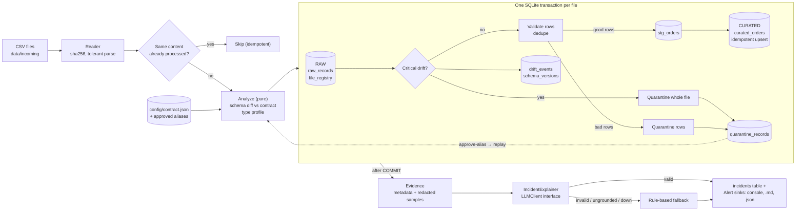
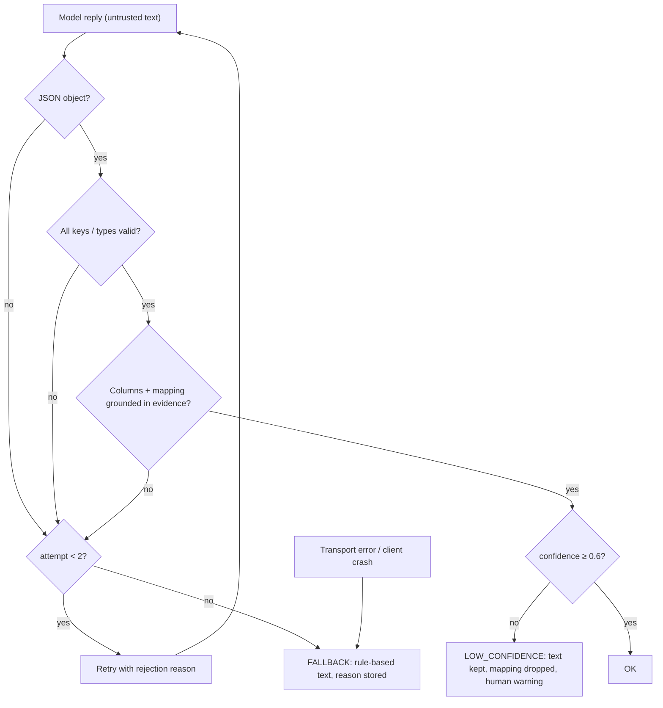

# Architecture

## Data flow

## AI validation ladder

## Sequence for the breaking-change day

1. `orders_2026-10-04.csv` arrives with `total_amount`, `order_status`.
2. Reader hashes it; not seen before. `analyze()` finds required `amount`/`status` missing and rename candidates whose values satisfy the contract → `RENAME_SUSPECTED` (CRITICAL).
3. Transaction: raw rows stored, **all 45 rows quarantined** (`FILE_QUARANTINED`), drift events + new schema version recorded, file status `QUARANTINED_FILE`, COMMIT. Curated table untouched.
4. Evidence built → explainer → validated explanation → `incidents` row → console + `.incident.md` + `.alert.json`.
5. Human: `approve-alias total_amount amount` (contract v+1) → `replay` re-analyzes from RAW, loads 45 rows, marks the quarantined file `SUPERSEDED` and its rows `REPLAYED`.
